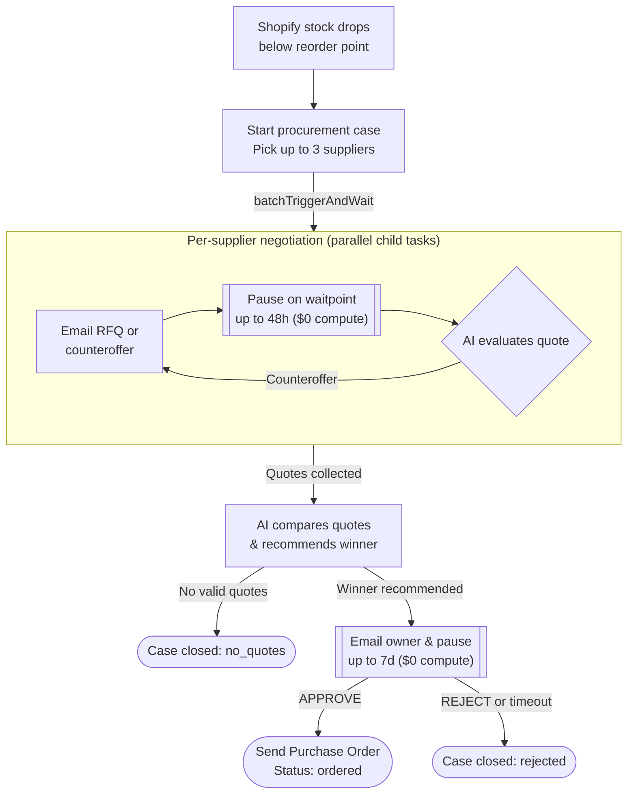
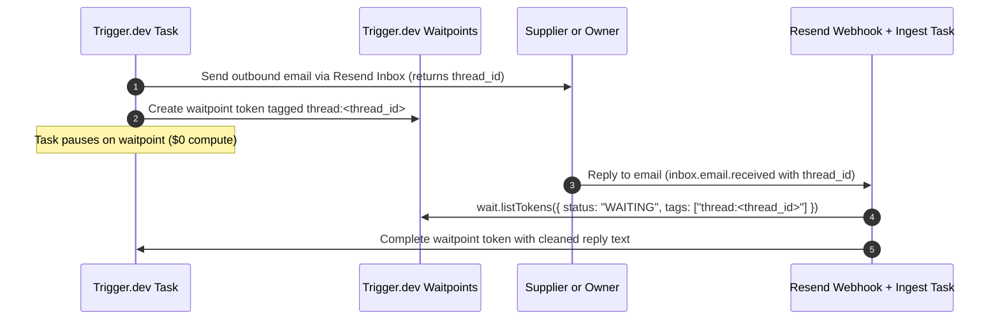

# Shopify Supplier Negotiator

An autonomous procurement agent for a Shopify store built with **Trigger.dev**, **Resend**, and the **Vercel AI SDK**.

When a Shopify `inventory_levels/update` webhook reports that stock has dropped to or below a SKU's reorder point, the agent loads the SKU's approved supplier panel from `src/lib/catalog.ts`, emails suppliers for quotes, negotiates counteroffers in parallel, compares landed costs and lead times, and **waits for the store owner to reply `APPROVE` by email** before issuing a purchase order.

> [!IMPORTANT]
> **Safe by default:** `EMAIL_MODE=mock` is the default configuration. Outbound emails are logged in the run trace without sending real mail, and helper tasks feed realistic replies through the same `ingest-inbound-email` router, `ToolLoopAgent`, and Trigger.dev waitpoint tokens used in production. Switch to `EMAIL_MODE=resend` when you want to send and receive real emails via Resend.

## Trigger.dev primitives used

- **Task:** A durable TypeScript background function with automatic retries and checkpointed state.
- **Webhook endpoint:** A hosted URL that verifies Shopify HMAC-SHA256 and Resend Svix signatures, deduplicates deliveries, and acknowledges within provider timeouts before running handlers.
- **Waitpoint token:** Suspends a running task for hours or days at zero compute cost until an inbound email webhook completes the token.
- **Concurrency limit and `concurrencyKey`:** Caps Shopify Admin GraphQL enrichment calls per store (`shopifyApiLimit`) and shares an LLM concurrency cap (`modelCallLimit`) across `negotiate-with-supplier` and `procurement-case`.
- **Idempotency key and bulk replay:** Prevents duplicate procurement cases, RFQs, and purchase orders when webhooks retry or failed runs are replayed in bulk.

## Architecture overview

### End-to-end procurement flow



### Zero-compute email waiting and correlation

Both supplier negotiations and owner approvals send the outbound email through the Resend Inbox, create a waitpoint token tagged with Resend's `thread_id` (`thread:<threadId>`), and pause with `wait.forToken()`. When an inbound reply arrives, `ingest-inbound-email` looks up the waiting token by its `thread:<threadId>` tag via `wait.listTokens()` and resumes the paused run:



1. **Waitpoint and thread correlation:** `negotiate-with-supplier` and `procurement-case` send the email through the Resend Inbox (capturing Resend's `thread_id`), create a Trigger.dev waitpoint token tagged with `thread:<threadId>`, and pause with `wait.forToken()`. Case progress, quotes, recommendations, and purchase orders are recorded directly on Trigger.dev run `metadata`.
2. **Inbound routing by `thread_id`:** When a reply arrives, `ingest-inbound-email` receives `thread_id` from the `inbox.email.received` webhook payload, fetches the email from Resend, strips quoted history, finds the waiting token with `wait.listTokens({ status: "WAITING", tags: [threadTag(threadId)] })`, and completes the waitpoint with the cleaned reply. Follow-up replies in `resend` mode use `resend.inboxes.threads.emails.reply()` to preserve email threading.
3. **Focused AI judgment:** Reorder triggers (`available <= reorderPoint`) and order quantities (`reorderQuantity`) live on each product in `src/lib/catalog.ts`. Each supplier negotiation runs a Vercel AI SDK `ToolLoopAgent` (`src/lib/agent.ts`) with `sendCounteroffer`, `answerQuestion`, and `finishNegotiation` tools (controlled by `stopWhen` and `prepareStep`), while `recommendSupplier` and `classifyOwnerReply` handle winner selection and owner approval replies.
4. **Identical pipeline across `mock` and `resend` modes:** Simulated replies in `src/trigger/demo.ts` pass through the same `ingest-inbound-email` router, `wait.completeToken()` calls, and AI SDK agents as live Resend webhooks.

## Project structure

```text
shopify-supplier-negotiator/
├── trigger.config.ts                  # Trigger.dev project and worker config
├── src/
│   ├── trigger/
│   │   ├── shopify-webhooks.ts        # Hosted Shopify webhook endpoint & subscriber
│   │   ├── resend-webhooks.ts         # Hosted Resend Inbox webhook endpoint & subscriber
│   │   ├── inventory-evaluation.ts    # SKU enrichment & deterministic reorder check
│   │   ├── procurement.ts             # Main durable procurement orchestrator
│   │   ├── supplier-negotiation.ts    # Per-supplier negotiation child task
│   │   ├── email-ingestion.ts         # Resend-to-waitpoint email router
│   │   └── demo.ts                    # Local stockout and reply simulation tasks
│   └── lib/
│       ├── agent.ts                   # Vercel AI SDK ToolLoopAgent, outputs & OTel
│       ├── email.ts                   # Resend SDK helpers, threading & waitpoint tags
│       ├── templates.ts               # Deterministic outbound email templates
│       ├── shopify.ts                 # Shopify Admin GraphQL SKU enrichment
│       ├── limits.ts                  # Named Trigger.dev concurrency limits
│       ├── catalog.ts                 # Demo catalog & suppliers
│       ├── types.ts                   # JSON-serializable domain types
│       └── email.test.ts              # Unit tests for email modes, tags & templates
```

## Quick start

### 1. Install dependencies, configure your Trigger.dev project ref, and create `.env.local`

Requires **Node.js 22 or later**:

```bash
npm install
cp .env.example .env.local
```

Go to [cloud.trigger.dev](https://cloud.trigger.dev), create a project, open **Project Settings**, copy your **Project ref** (`proj_...`), and set it as `project` in `trigger.config.ts`:

```ts
// trigger.config.ts
export default defineConfig({
  project: "proj_your_project_ref_here",
  // ...
});
```

Set the required variables in `.env.local`:

```bash
OPENAI_API_KEY=sk-...
AI_MODEL=gpt-6.1-terra
OWNER_EMAIL=you@example.com
EMAIL_MODE=mock
```

Optional variables:

- `OPENAI_BASE_URL`: Custom base URL for an OpenAI-compatible gateway.
- `SHOPIFY_STORE_DOMAIN` and `SHOPIFY_ADMIN_ACCESS_TOKEN`: Enables live Shopify Admin GraphQL enrichment.
- `RESEND_API_KEY` and `RESEND_INBOX_ID`: Enables real email sending and inbound email fetching (`EMAIL_MODE=resend`).

### 2. Verify typecheck and unit tests

```bash
npm run typecheck
npm test
```

### 3. Start the worker and trigger a stockout

Start the local worker:

```bash
npm run dev
```

In a second terminal, trigger a simulated stockout for `ESP-GASKET-58`:

```bash
npm run demo:stockout
```

Open the **`procurement-case`** run in the Trigger.dev dashboard to inspect the live run `metadata` (`status`, `recommended`, `poNumber`, and full `case` object) and the final output payload.

You can also trigger other SKUs or simulate a rejected owner reply:

```bash
# Trigger a stockout for 64mm flat burrs
npx trigger.dev tasks trigger simulate-inventory-low \
  --payload '{"sku":"BURRS-64"}'

# Simulate an owner rejection for an open approval waitpoint
npx trigger.dev tasks trigger simulate-owner-reply \
  --payload '{"tokenId":"waitpoint_...","replyText":"Reject. Too expensive this month."}'
```

## Deploying with live Shopify and Resend

1. **Shopify Admin API token:** In Shopify Admin, go to **Settings > Apps > Develop apps > Create an app**, open **Configuration > Admin API integration**, enable `read_inventory` and `read_products`, click **Save**, and click **Install app**. Under **API credentials > Admin API access token**, click **Reveal token once** and set `SHOPIFY_STORE_DOMAIN` and `SHOPIFY_ADMIN_ACCESS_TOKEN`. (If your store routes **Develop apps** to the 2026 Shopify Dev Dashboard instead, create and install the app there and request a 24-hour `shpat_...` token from `POST https://<shop>.myshopify.com/admin/oauth/access_token` with `grant_type: "client_credentials"`.)
2. **Shopify webhook (Admin UI):** In Shopify Admin, go to **Settings > Notifications > Webhooks > Create webhook**, choose **Event: Inventory levels update**, **Format: JSON**, paste the Trigger.dev `shopify` webhook URL, and click **Save**. Copy the signing secret shown at the bottom of the **Webhooks** page into the `shopify` endpoint in Trigger.dev.
3. **Product catalog & suppliers:** Update `src/lib/catalog.ts` so `PRODUCTS` includes your Shopify product SKU(s) and set `SUPPLIER_EMAIL_1`, `SUPPLIER_EMAIL_2`, and `SUPPLIER_EMAIL_3` (or update `SUPPLIERS` in `src/lib/catalog.ts`) with real supplier or test email addresses instead of `.example` placeholders.
4. **Resend:** Verify your domain, create a Resend Inbox, register the Trigger.dev `resend` webhook URL for `inbox.email.received`, and paste the Svix signing secret into Trigger.dev. Set `RESEND_API_KEY`, `RESEND_INBOX_ID`, `PROCUREMENT_FROM_EMAIL`, `PROCUREMENT_REPLY_TO` (your Resend Inbox address), `OWNER_EMAIL`, `SUPPLIER_EMAIL_1..3`, and `EMAIL_MODE=resend`.
5. **Deploy:** In the Trigger.dev dashboard (**Environment Variables**), set all required production variables (`OPENAI_API_KEY`, `OPENAI_BASE_URL` if used, `AI_MODEL`, `OWNER_EMAIL`, `SUPPLIER_EMAIL_1`, `SUPPLIER_EMAIL_2`, `SUPPLIER_EMAIL_3`, `EMAIL_MODE=resend`, `RESEND_API_KEY`, `RESEND_INBOX_ID`, `PROCUREMENT_FROM_EMAIL`, `PROCUREMENT_REPLY_TO`, `SHOPIFY_STORE_DOMAIN`, and `SHOPIFY_ADMIN_ACCESS_TOKEN`), then run `npm run deploy`. (Remove `src/trigger/demo.ts` if you do not want demo tasks deployed in production.)

Licensed under [Apache 2.0](./LICENSE).
